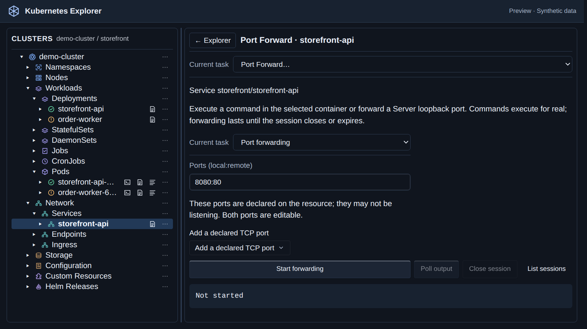

# OpenChamber Kubernetes Explorer

English | [简体中文](docs/i18n/README.zh-CN.md) | [العربية](docs/i18n/README.ar.md) | [Deutsch](docs/i18n/README.de.md) | [Español](docs/i18n/README.es.md) | [Français](docs/i18n/README.fr.md) | [עברית](docs/i18n/README.he.md) | [日本語](docs/i18n/README.ja.md) | [한국어](docs/i18n/README.ko.md) | [Nederlands](docs/i18n/README.nl.md) | [Polski](docs/i18n/README.pl.md) | [Português (Brasil)](docs/i18n/README.pt-BR.md) | [Türkçe](docs/i18n/README.tr.md) | [Українська](docs/i18n/README.uk.md) | [繁體中文](docs/i18n/README.zh-TW.md)

A Kubernetes extension for OpenChamber. Browse clusters, troubleshoot workloads, and perform common Kubernetes operations without leaving your project workspace.

## Screenshots

Desktop previews with synthetic data; no cluster connection or operations were run. Select a screenshot to view it full size.

| Resource explorer | Resource details |
| --- | --- |
| [](docs/screenshots/explorer.png) | [](docs/screenshots/resource-details.png) |
| **Container terminal** | **Port forwarding** |
| [](docs/screenshots/terminal.png) | [](docs/screenshots/port-forward.png) |

## Installation

Once the prebuilt extension files are published to the repository's default branch:

1. Open **Settings → Extensions** in OpenChamber.
2. Paste the repository URL into **Folder, ZIP, or URL** and click **Add**:

   ```text
   https://github.com/hlhr202/Openchamber-Kubernetes
   ```

3. Review and allow the requested local service capability, then open **Kubernetes** from the extension rail.

No local build or JavaScript dependency installation is required. While the repository is private, the OpenChamber server must already have Git credentials that can read it over HTTPS. Signing in to GitHub in your browser does not provide those credentials to the server.

The [Docker-verified candidate](docs/status.md) also has a prebuilt ZIP for manual installation. Git URL installation has not yet been verified.

## Prerequisites

- **OpenChamber 2.5.1**, the version targeted by this extension.
- A working **kubeconfig** available to the OS user running OpenChamber Server, with network access to the Kubernetes API and permissions for the actions you intend to use.
- **`kubectl`** available on the server. **Helm** is needed for actions that invoke the Helm CLI. If your kubeconfig uses an external credential helper, it must also be available on the server. The extension does not install these tools.

## Features

- Switch Kubernetes contexts and namespaces, and browse workloads, services, and custom resources in a resource tree.
- Inspect resource manifests, read Pod logs, and view namespace events.
- Review manifest changes and explicitly apply them to the selected target.
- Open a terminal in a selected container or set up port forwarding.
- Browse Helm repositories, charts, releases, and revision history.

## What the Author Tested

The author has personally tested only four workflows: expanding resource lists in the tree, viewing resource details, using a container terminal, and forwarding ports. If you run into problems or have questions about other workflows, please [open a GitHub issue](https://github.com/hlhr202/Openchamber-Kubernetes/issues).

## Privacy

- The extension does not send telemetry or analytics to its developers. It uses your server-side kubeconfig to connect to the configured Kubernetes API under your existing permissions.
- The extension keeps fetched resource data, logs, terminal output, and unsaved drafts in memory rather than writing them to disk. It persists nonsensitive preferences such as kubeconfig source selections, not kubeconfig contents. Explicit saves or exports are separate actions.
- Secret values are shown only on request, subject to your Kubernetes permissions. Cluster data is not sent to chat or a model provider automatically.

This statement covers the extension, not OpenChamber, Kubernetes, or external tools and services you use with it.

## License

[MIT](LICENSE). Bundled dependencies retain their respective licenses; see `THIRD_PARTY_NOTICES.txt` in the prebuilt package.

[Project documentation](docs/README.md) · [Product scope](docs/product.md) · [Development](docs/development.md)
