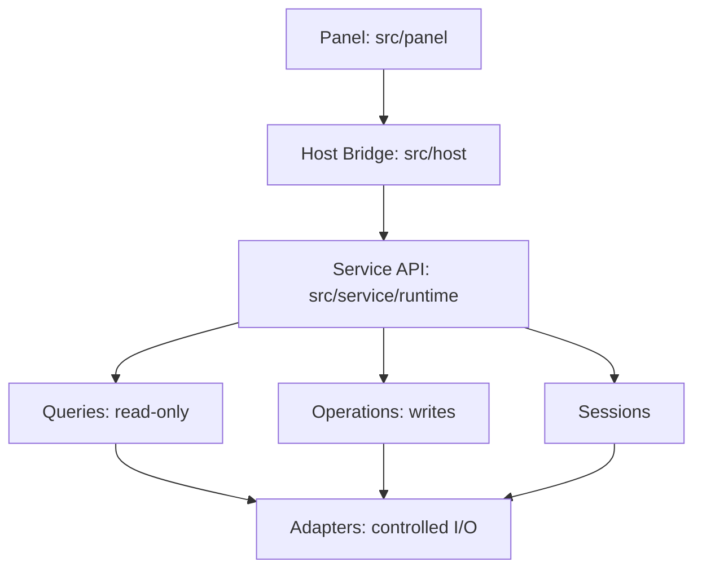

# Architecture

This document defines the architecture and engineering constraints. It does not establish that every feature is implemented or accepted. See the [product scope](./product.md).

## Host and Execution Environment

- Integrate only with the official OpenChamber `2.5.1` release and pin `@openchamber/sdk` to `2.5.1`. Do not modify the host or SDK, use unpublished interfaces, or upgrade the baseline automatically. Server targets are macOS arm64 and Linux x64. Client targets include the macOS desktop app and supported web browsers, including connections to remote servers.
- The host starts `runtime: host` and may not use the Node executable on the system `PATH`. Verify the Node 24 development environment, host runtime, and browser target separately. CLI tools, filesystem operations, applications, and adapters run as the server OS user. The browser starts no local process; there is no client agent.
- A trusted single-user instance supports multiple devices. Owner, project, and view boundaries prevent cross-session and wrong-target operations; they do not provide separate kubeconfigs, RBAC, OS sandboxing, or tenant isolation. Server loopback is not client localhost. Remote access must use the official preview or an authenticated plugin route. Do not listen publicly by default.
- Deliver prebuilt plugin JavaScript and the required assets that can legally be bundled. Users provide kubectl, Helm, external debuggers, and platform tools. Report missing or incompatible tools without downloading them, escalating privileges, or modifying the host. Do not gate kubectl on a version number or probe the server version. Bound the local client probe and determine command availability from its actual result.

## Module Boundaries

- The panel uses TypeScript with the native DOM and SDK UI. It renders validated data and forwards user intent. The host bridge centralizes SDK calls, generation checks, capabilities, and message delivery. The panel does not access the cluster, service listener, or server files directly.
- The service exposes a versioned API on the host-assigned loopback address. Every entry point enforces authentication, schema, size, expiry, target, and permission checks. An identity asserted by an iframe is not trusted. Public DTOs are separate from execution models. Errors use stable codes and do not return credentials, raw error bodies, or sensitive responses.
- `src/shared` contains only portable schemas, types, and pure functions. Read and presentation code does not import write executors. Adapters do not infer authorization from the DOM. Imports do not make network requests, run tools, or load sessions. Side effects occur only at explicit entry points.

## Project Workspaces and Reads

- The service owns one workspace per normalized project directory. It holds the tree, observation tasks, editing baselines and drafts, operation state, and the UI snapshot. The iframe is a viewer. Changing chats within a project does not reset the workspace. Switching projects or destroying an iframe only detaches the viewer; project tasks remain open. Reattaching restores in-memory state without replaying input, restarting sessions, or rereading the cluster to simulate restoration.
- State is isolated by service, project, and target generation. Changes to the actual target, configuration, or authorization invalidate previous controls and read results; drafts may remain marked stale. Restoration is not guaranteed after service shutdown, plugin update or disablement, process loss, or edits not yet acknowledged. Routine background sync shows no progress, but real failures remain visible. Deduplicate identical snapshots, defer rendering while hidden, and checkpoint user changes within a bounded interval.
- Reads are bound to configuration identity, context, namespace, and exact group, version, and resource (GVR). Check object UID and resource version when required. Bound requests in flight, queue length, timeouts, and response bytes. Canceling one consumer does not affect the others, and the request holds its slot until the underlying work finishes. A cursor binds the original query, list version, and fixed expiry. Do not mix pages across targets, fetch pages automatically, or switch transports and replay a failed LIST.
- The server resolves kubeconfig from explicit sources or from the `KUBECONFIG`, `HOME`, and working directory actually available to the service. Source order affects merging and write targets. Do not assume the host forwards environment variables. If `KUBECONFIG` is set and none of its sources exist, do not fall back to `HOME`. The service manages source preferences, shared under the same `HOME`, rather than using project or SDK instance storage. It does not store configuration contents there.
- Obtain credentials for the selected kubeconfig on demand for actual cluster requests, not when browsing configuration or loading the panel. A bounded, non-interactive executor supplied by the runtime handles `ExecCredential`. Credentials have a short-lived in-memory cache, and concurrent authentication requests share work. Recheck the source after authentication. A 401 invalidates the matching credentials without replaying the failed request. Do not offer a separate authentication button or silently install tools or log in. CLI workers receive only a resolved static snapshot through a dedicated FIFO; do not write a credential-bearing kubeconfig to a regular file. Worker deadlines and owned-process cleanup do not guarantee zero orphan processes at the OS level.
- Compatible lists negotiate metadata over one bounded HTTPS request under the shared request gate. Configurations that cannot use this transport are routed to the CLI before issuing the request. The same HTTPS request may return full JSON. TLS or HTTP failure does not trigger another transport. See the [Explorer spec](./features/9-resource-explorer-ux-and-request-control/spec.md) for eligible lists, projected fields, and CRD checks.

## Writes, Sessions, and Data

- Only explicit user intent enters the shared write gate. Check permissions and parameters; bind the original target, version, payload, and time-limited confirmation; recheck before submission; then record the outcome against the original operation. Deduplicate requests without promising exactly-once execution. Do not automatically retry, roll back, or start dependent steps when a result fails or is unknown. Switching views must not discard a submitted result or deliver it to a new target. File and kubeconfig writes check the real path, symlinks, version, and plugin-local lock; they cannot rule out races from external processes.
- Server processes use fixed adapters and argument arrays, not concatenated local shell commands. Terminal and Exec bind to the actual target container; Port Forward binds to the original target and resolved backend. Control, lease renewal, reattachment, and cleanup stay within the original owner, target, and time limit. Do not replay input or recreate sessions automatically. The plugin supplies xterm, while the interactive PTY lives in the target container, not in a local PTY plugin. Observation tasks are independent of writable sessions.
- Resources, logs, drafts, terminal screens, and debug values stay in bounded memory. Tree DTOs carry only approved fields. Secret values are returned only when explicitly viewed and do not enter the tree, URLs, preferences, diagnostics, chat, or telemetry. Store only nonsensitive preferences. An explicit Save or Export is not automatic persistence. Render external content as text and validate paths, links, and byte budgets when extracting archives.

## Build and Verification

- Use Node 24, TypeScript 7, a pinned pnpm 12 release, and Rolldown/Oxc. Builds do not replace independent type checks or lint. Use strict TypeScript, explicit `.ts` relative imports, and separate NodeNext and browser configurations. Scripts run directly by Node use only erasable syntax. Validate external data before it enters typed state.
- The panel builds to a classic ES2022 IIFE with no Node built-ins, bare imports, or remote CDN dependencies. The service builds to Node 24 ESM with Node built-ins kept external. Build inputs and declared assets are the source of truth; do not edit generated files directly. Do not use the experimental Rolldown watcher or call repeated builds incremental watching.
- Verification and packaging use frozen inputs and the same build snapshot. A candidate ID binds the inputs and the installable content digest. Identical inputs produce identical ZIP bytes. Manual acceptance must identify the actual installed artifact and platform. Source checks, synthetic browser results, builds, and real runtime results are not interchangeable. See [development](./development.md) for commands and isolation and [hard limits](./README.md#hard-limits) for verification boundaries.
