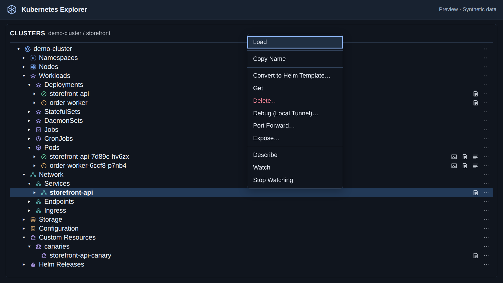

# OpenChamber Kubernetes Explorer

[English](../../README.md) | [简体中文](README.zh-CN.md) | [العربية](README.ar.md) | Deutsch | [Español](README.es.md) | [Français](README.fr.md) | [עברית](README.he.md) | [日本語](README.ja.md) | [한국어](README.ko.md) | [Nederlands](README.nl.md) | [Polski](README.pl.md) | [Português (Brasil)](README.pt-BR.md) | [Türkçe](README.tr.md) | [Українська](README.uk.md) | [繁體中文](README.zh-TW.md)

Eine Kubernetes-Erweiterung für OpenChamber. Du kannst Cluster durchsuchen, Probleme mit Workloads untersuchen und gängige Kubernetes-Vorgänge ausführen, ohne deinen Projektarbeitsbereich zu verlassen.

## Screenshots

Desktop-Vorschauen mit Beispieldaten. Es wurde keine Verbindung zu einem Cluster hergestellt und keine Aktion ausgeführt. Ein Klick auf das Bild öffnet die Originalgröße.

| Ressourcen-Explorer | Ressourcendetails |
| --- | --- |
| [](../screenshots/explorer.png) | [](../screenshots/resource-details.png) |
| **Container-Terminal** | **Portweiterleitung** |
| [](../screenshots/terminal.png) | [](../screenshots/port-forward.png) |

## Installation

Sobald die vorgefertigten Erweiterungsdateien im Standardbranch des Repositorys veröffentlicht sind:

1. Öffne in OpenChamber **Einstellungen → Erweiterungen**.
2. Füge die Repository-URL in das Feld **Ordner, ZIP oder URL** ein und klicke auf **Hinzufügen**:

   ```text
   https://github.com/hlhr202/Openchamber-Kubernetes
   ```

3. Prüfe und erteile die angeforderte Berechtigung für den lokalen Dienst. Öffne dann **Kubernetes** in der Erweiterungsleiste.

Du musst weder lokal kompilieren noch JavaScript-Abhängigkeiten installieren. Solange das Repository privat ist, benötigt OpenChamber Server bereits Git-Zugangsdaten mit Leserecht über HTTPS. Eine Anmeldung bei GitHub im Browser stellt dem Server diese Zugangsdaten nicht zur Verfügung.

Der [in Docker geprüfte Release-Kandidat](../status.md) ist auch als vorgefertigte ZIP-Datei zur manuellen Installation verfügbar. Die Installation über eine Git-URL wurde noch nicht geprüft.

## Voraussetzungen

- **OpenChamber 2.5.1** ist die Zielversion der Erweiterung.
- Eine funktionsfähige **kubeconfig**, auf die das Betriebssystemkonto von OpenChamber Server zugreifen kann, sowie Netzwerkzugriff auf die Kubernetes-API und die Rechte für die gewünschten Vorgänge.
- **`kubectl`** muss auf dem Server verfügbar sein. **Helm** ist für Vorgänge erforderlich, die die Helm-CLI aufrufen. Ein von der kubeconfig verwendeter externer Anmeldehelfer muss ebenfalls auf dem Server verfügbar sein. Die Erweiterung installiert diese Werkzeuge nicht.

## Funktionen

- Kubernetes-Kontexte und Namespaces wechseln und Workloads, Dienste sowie benutzerdefinierte Ressourcen im Ressourcenbaum durchsuchen.
- Ressourcenmanifeste, Pod-Protokolle und Namespace-Ereignisse ansehen.
- Manifeständerungen prüfen und gezielt auf das ausgewählte Ziel anwenden.
- Ein Terminal im ausgewählten Container öffnen oder eine Portweiterleitung einrichten.
- Helm-Repositorys, Charts, Releases und den Revisionsverlauf durchsuchen.

## Was der Autor getestet hat

Der Autor hat nur vier Abläufe selbst getestet: Ressourcenlisten im Baum aufklappen, Ressourcendetails ansehen, ein Containerterminal nutzen und Ports weiterleiten. Bei Fragen oder Problemen mit anderen Abläufen kannst du gerne [ein GitHub-Issue eröffnen](https://github.com/hlhr202/Openchamber-Kubernetes/issues).

## Datenschutz

- Die Erweiterung sendet weder Telemetrie- noch Analysedaten an ihre Entwickler. Sie nutzt die kubeconfig auf dem Server, um sich mit deinen vorhandenen Berechtigungen mit der konfigurierten Kubernetes-API zu verbinden.
- Abgerufene Ressourcendaten, Protokolle, Terminalausgaben und ungespeicherte Entwürfe bleiben im Arbeitsspeicher und werden nicht auf Datenträger geschrieben. Gespeichert werden nicht sensible Einstellungen wie die Auswahl der kubeconfig-Quellen, nicht deren Inhalte. Bewusstes Speichern oder Exportieren sind separate Aktionen.
- Secret-Werte werden nur auf Anfrage und entsprechend deinen Kubernetes-Berechtigungen angezeigt. Clusterdaten werden nicht automatisch an den Chat oder einen Modellanbieter gesendet.

Diese Erklärung gilt für die Erweiterung, nicht für OpenChamber, Kubernetes oder andere verwendete Werkzeuge und Dienste.

## Lizenz

[MIT](../../LICENSE). Mitgelieferte Abhängigkeiten behalten ihre jeweiligen Lizenzen; siehe `THIRD_PARTY_NOTICES.txt` im vorgefertigten Paket.

[Projektdokumentation](../README.md) · [Funktionsumfang](../product.md) · [Entwicklung](../development.md)
