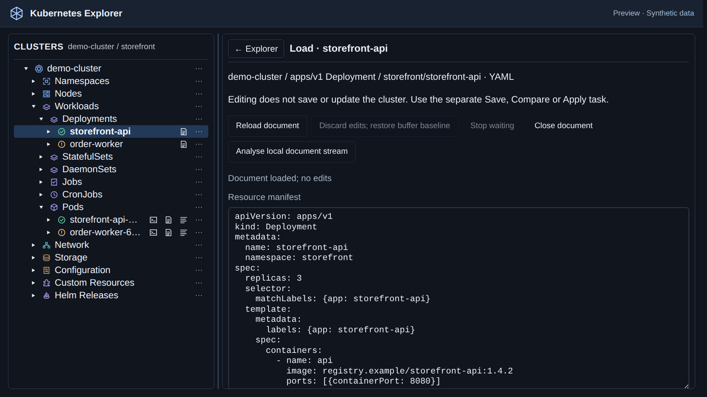

# OpenChamber Kubernetes Explorer

[English](../../README.md) | [简体中文](README.zh-CN.md) | [العربية](README.ar.md) | [Deutsch](README.de.md) | [Español](README.es.md) | [Français](README.fr.md) | [עברית](README.he.md) | [日本語](README.ja.md) | [한국어](README.ko.md) | [Nederlands](README.nl.md) | [Polski](README.pl.md) | Português (Brasil) | [Türkçe](README.tr.md) | [Українська](README.uk.md) | [繁體中文](README.zh-TW.md)

Uma extensão do Kubernetes para o OpenChamber. Explore clusters, investigue problemas nas cargas de trabalho e execute operações comuns do Kubernetes sem sair do espaço de trabalho do seu projeto.

## Capturas de tela

Prévias da interface para desktop com dados fictícios. Nenhum cluster foi acessado e nenhuma operação foi executada. Clique em uma captura para vê-la em tamanho real.

| Explorador de recursos | Detalhes do recurso |
| --- | --- |
| [](../screenshots/explorer.png) | [](../screenshots/resource-details.png) |
| **Terminal do contêiner** | **Encaminhamento de portas** |
| [](../screenshots/terminal.png) | [](../screenshots/port-forward.png) |

## Instalação

Depois que os arquivos pré-compilados da extensão forem publicados no branch padrão do repositório:

1. No OpenChamber, abra **Configurações → Extensões**.
2. Cole a URL do repositório em **Pasta, ZIP ou URL** e clique em **Adicionar**:

   ```text
   https://github.com/hlhr202/Openchamber-Kubernetes
   ```

3. Confira e autorize o acesso ao serviço local solicitado. Em seguida, abra **Kubernetes** na barra de extensões.

Não é preciso compilar localmente nem instalar dependências de JavaScript. Enquanto o repositório for privado, o OpenChamber Server precisa já ter credenciais do Git com acesso de leitura via HTTPS. Entrar no GitHub pelo navegador não fornece essas credenciais ao servidor.

A [versão candidata verificada no Docker](../status.md) também oferece um ZIP pré-compilado para instalação manual. A instalação pela URL do Git ainda não foi verificada.

## Pré-requisitos

- **OpenChamber 2.5.1**, a versão para a qual esta extensão foi desenvolvida.
- Um **kubeconfig** válido, acessível à conta do sistema operacional que executa o OpenChamber Server, com acesso de rede à API do Kubernetes e permissões para as operações desejadas.
- **`kubectl`** disponível no servidor. As operações que chamam a CLI do Helm exigem **Helm**. Se o kubeconfig usar um utilitário externo de credenciais, ele também deve estar disponível no servidor. A extensão não instala essas ferramentas.

## Recursos

- Alterne entre contextos e namespaces do Kubernetes e navegue por cargas de trabalho, serviços e recursos personalizados na árvore de recursos.
- Inspecione manifestos, leia logs de Pods e veja eventos de namespaces.
- Revise alterações nos manifestos e aplique-as explicitamente ao destino selecionado.
- Abra um terminal no contêiner selecionado ou configure o encaminhamento de portas.
- Explore repositórios, charts, releases e o histórico de revisões do Helm.

## O que o autor testou

O autor testou pessoalmente apenas quatro fluxos: expandir listas na árvore de recursos, ver detalhes de recursos, usar o terminal de um contêiner e encaminhar portas. Se tiver dúvidas ou encontrar problemas em outros fluxos, fique à vontade para [abrir uma issue no GitHub](https://github.com/hlhr202/Openchamber-Kubernetes/issues).

## Privacidade

- A extensão não envia dados de telemetria nem de análise aos desenvolvedores. Ela usa o kubeconfig do servidor para se conectar à API do Kubernetes configurada, com as permissões que você já tem.
- Os dados de recursos obtidos, os logs, a saída do terminal e os rascunhos não salvos ficam na memória e não são gravados em disco. A extensão salva preferências não sensíveis, como a seleção das fontes de kubeconfig, mas não o conteúdo dos arquivos. Salvar ou exportar explicitamente são ações distintas.
- Os valores de Secrets só são exibidos quando você os solicita e suas permissões do Kubernetes permitem. Os dados do cluster não são enviados automaticamente ao chat nem a um provedor de modelos.

Esta declaração se aplica à extensão, não ao OpenChamber, ao Kubernetes ou a ferramentas e serviços externos que você usa com ela.

## Licença

[MIT](../../LICENSE). As dependências incluídas mantêm suas respectivas licenças. Consulte `THIRD_PARTY_NOTICES.txt` no pacote pré-compilado.

[Documentação do projeto](../README.md) · [Escopo do produto](../product.md) · [Desenvolvimento](../development.md)
