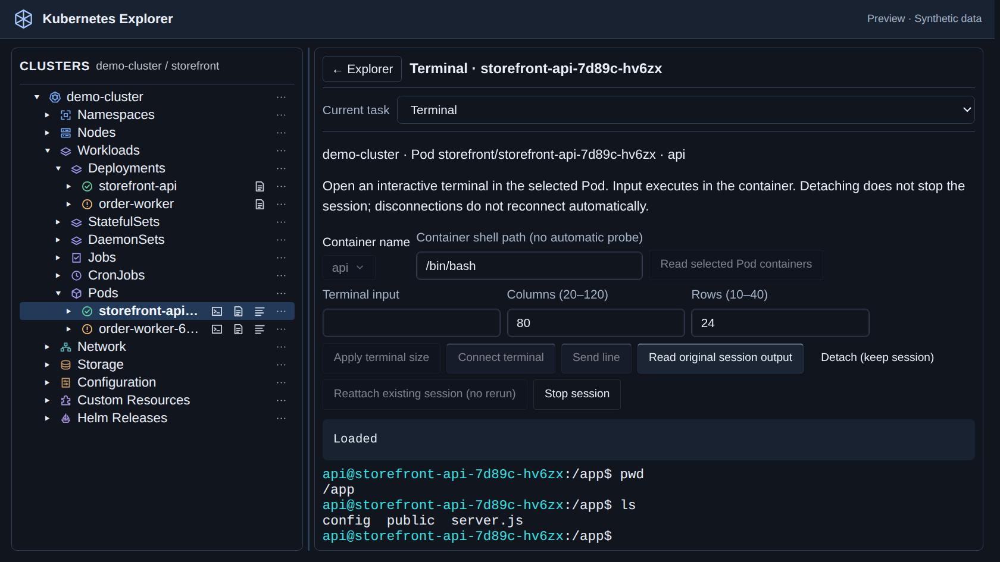

# OpenChamber Kubernetes Explorer

[English](../../README.md) | [简体中文](README.zh-CN.md) | [العربية](README.ar.md) | [Deutsch](README.de.md) | [Español](README.es.md) | [Français](README.fr.md) | [עברית](README.he.md) | [日本語](README.ja.md) | [한국어](README.ko.md) | [Nederlands](README.nl.md) | [Polski](README.pl.md) | [Português (Brasil)](README.pt-BR.md) | Türkçe | [Українська](README.uk.md) | [繁體中文](README.zh-TW.md)

OpenChamber için bir Kubernetes eklentisi. Proje çalışma alanınızdan ayrılmadan kümeleri inceleyebilir, iş yüklerindeki sorunları araştırabilir ve yaygın Kubernetes işlemlerini yapabilirsiniz.

## Ekran görüntüleri

Örnek verilerle hazırlanmış masaüstü önizlemeleri. Kümeye bağlanılmadı ve hiçbir işlem çalıştırılmadı. Tam boyutta görmek için bir görüntüye tıklayın.

| Kaynak gezgini | Kaynak ayrıntıları |
| --- | --- |
| [](../screenshots/explorer.png) | [](../screenshots/resource-details.png) |
| **Kapsayıcı terminali** | **Bağlantı noktası yönlendirme** |
| [](../screenshots/terminal.png) | [](../screenshots/port-forward.png) |

## Kurulum

Önceden derlenmiş eklenti dosyaları deponun varsayılan dalında yayımlandıktan sonra:

1. OpenChamber’da **Ayarlar → Eklentiler** bölümünü açın.
2. Depo adresini **Klasör, ZIP veya URL** alanına yapıştırın ve **Ekle**’ye tıklayın:

   ```text
   https://github.com/hlhr202/Openchamber-Kubernetes
   ```

3. İstenen yerel hizmet iznini inceleyip onaylayın, ardından eklenti çubuğundan **Kubernetes**’i açın.

Yerel derleme veya JavaScript bağımlılıklarını kurma gerekmez. Depo özel olduğu sürece OpenChamber Server’ın depoyu HTTPS üzerinden okuyabilen Git kimlik bilgilerine önceden sahip olması gerekir. Tarayıcıda GitHub hesabınıza giriş yapmanız bu bilgileri sunucuya sağlamaz.

[Docker’da doğrulanan aday sürüm](../status.md) elle kurulum için önceden derlenmiş bir ZIP de sunar. Git URL’siyle kurulum henüz doğrulanmadı.

## Ön koşullar

- Eklentinin hedeflediği sürüm olan **OpenChamber 2.5.1**.
- OpenChamber Server’ı çalıştıran işletim sistemi kullanıcısının erişebildiği, çalışan bir **kubeconfig**; ayrıca Kubernetes API’sine ağ erişimi ve yapmak istediğiniz işlemler için gerekli izinler.
- Sunucuda **`kubectl`** bulunmalıdır. Helm CLI’yi çağıran işlemler için **Helm** gerekir. Kubeconfig harici bir kimlik bilgisi yardımcısı kullanıyorsa bu araç da sunucuda bulunmalıdır. Eklenti bu araçları kurmaz.

## Özellikler

- Kubernetes bağlamları ve ad alanları arasında geçiş yapın; kaynak ağacında iş yüklerine, servislere ve özel kaynaklara göz atın.
- Kaynak bildirimlerini inceleyin, Pod günlüklerini okuyun ve ad alanı olaylarını görüntüleyin.
- Bildirimlerdeki değişiklikleri gözden geçirin ve bunları açıkça seçtiğiniz hedefe uygulayın.
- Seçilen konteynerde bir terminal açın veya bağlantı noktası yönlendirmesi ayarlayın.
- Helm depolarına, chart’lara, sürümlere ve revizyon geçmişine göz atın.

## Yazarın test ettiği işlemler

Yazar yalnızca dört işlemi bizzat test etti: kaynak ağacında listeleri genişletme, kaynak ayrıntılarını görüntüleme, konteyner terminalini kullanma ve bağlantı noktası yönlendirme. Diğer işlemlerde sorunla karşılaşırsanız veya sorunuz varsa [GitHub’da bir issue açabilirsiniz](https://github.com/hlhr202/Openchamber-Kubernetes/issues).

## Gizlilik

- Eklenti, geliştiricilerine telemetri veya analiz verisi göndermez. Mevcut izinlerinizle yapılandırılan Kubernetes API’sine bağlanmak için sunucudaki kubeconfig’i kullanır.
- Alınan kaynak verileri, günlükler, terminal çıktısı ve kaydedilmemiş taslaklar bellekte tutulur; diske yazılmaz. Kubeconfig kaynağı seçimi gibi hassas olmayan tercihler saklanır, ancak kubeconfig içeriği saklanmaz. Açıkça başlattığınız kaydetme ve dışa aktarma işlemleri ayrıdır.
- Secret değerleri yalnızca isteğiniz üzerine ve Kubernetes izinleriniz elverdiği ölçüde gösterilir. Küme verileri sohbete veya bir model sağlayıcısına otomatik olarak gönderilmez.

Bu açıklama yalnızca eklenti için geçerlidir; OpenChamber, Kubernetes veya birlikte kullandığınız harici araç ve hizmetleri kapsamaz.

## Lisans

[MIT](../../LICENSE). Paketle gelen bağımlılıklar kendi lisanslarını korur. Önceden derlenmiş paketteki `THIRD_PARTY_NOTICES.txt` dosyasına bakın.

[Proje belgeleri](../README.md) · [Ürün kapsamı](../product.md) · [Geliştirme](../development.md)
